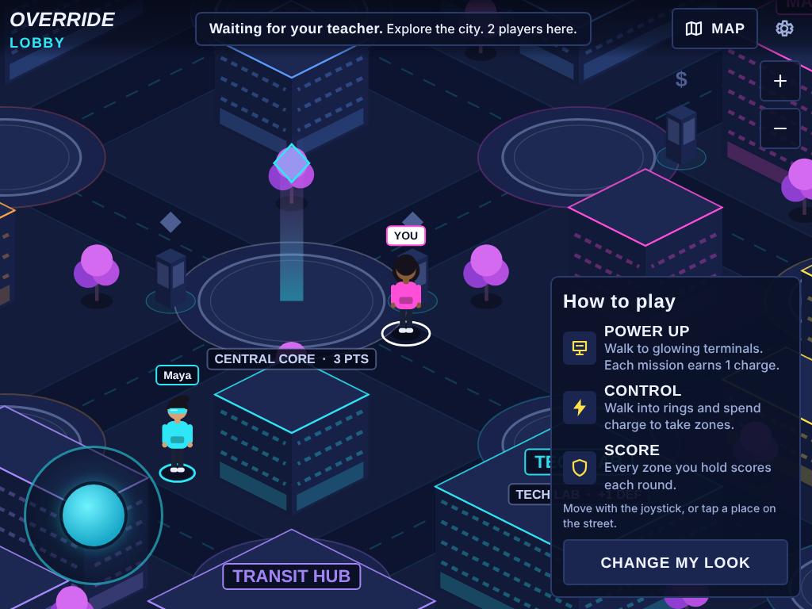
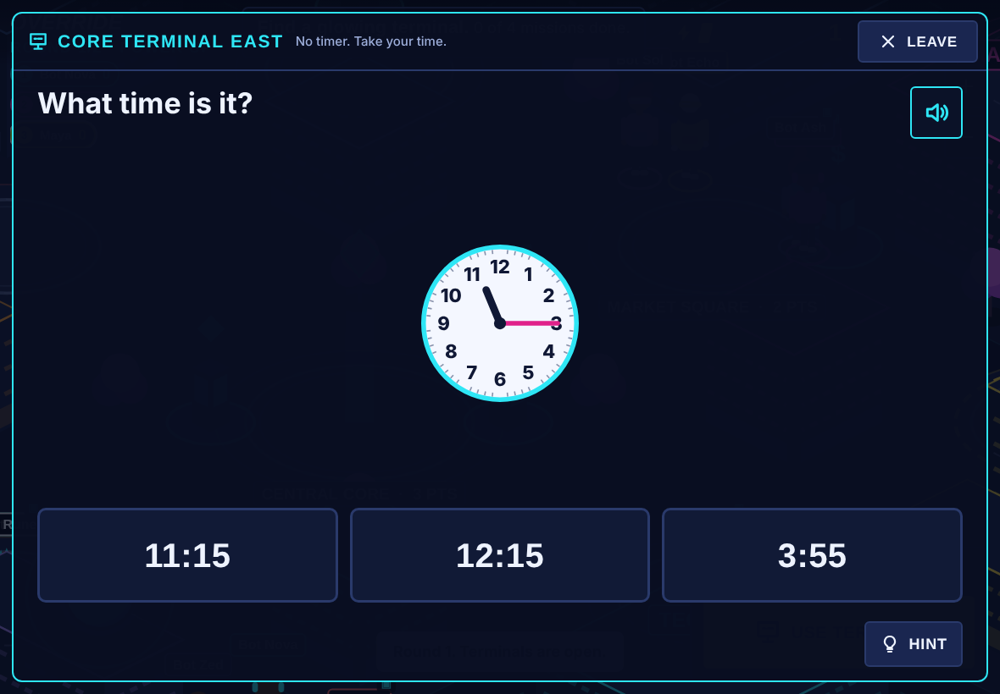
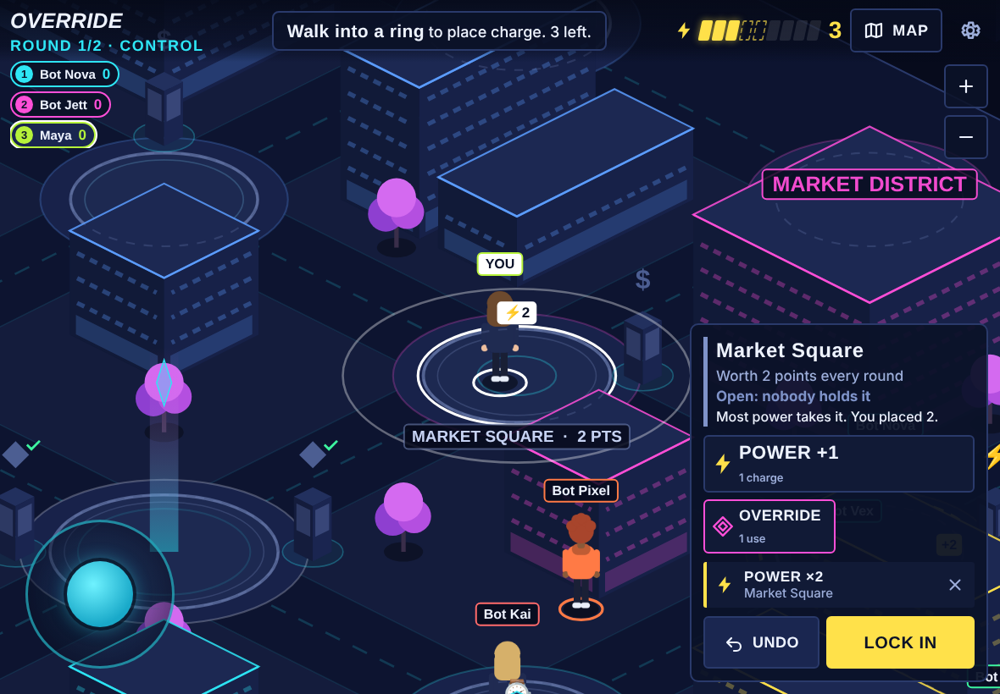
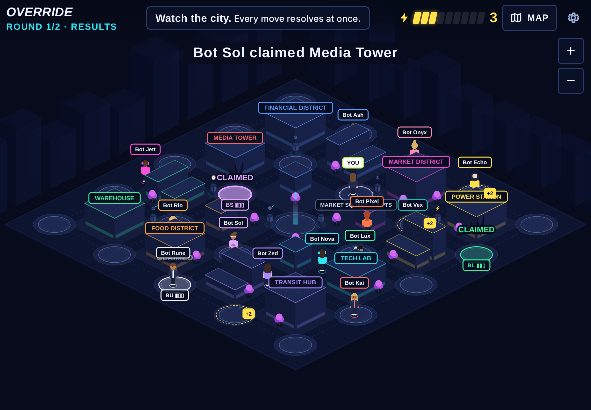
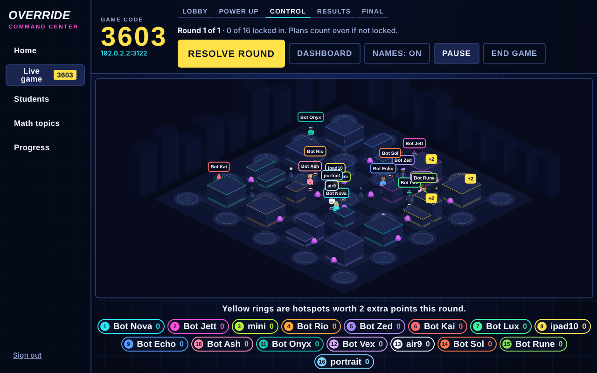

# OVERRIDE: Control the Grid

A walkable, multiplayer life-skills math game for a high school Life Skills classroom. Students walk avatars through a shared neon city, visit terminals for individualized real-world math missions, then walk into capture rings and spend what they earned to take and hold zones. The teacher runs the session from a separate command center and sees private progress data that students never see.

Built for about 15 students on iPads (Safari, landscape) and one teacher on a computer or iPad.



---

## Run it

You need **Node.js 22.5 or newer** (it has SQLite built in). Nothing else installs: the project has no npm dependencies.

```bash
cd override
npm start
```

The terminal prints:

```
  Teacher command center:  http://localhost:3000/teacher
  Teacher PIN:             482913
  Students join at:        http://192.168.1.20:3000
```

- Open the teacher address, sign in with the PIN, choose **Live game**, then **Create game**.
- Write the student address and the 4-digit code on the board.
- Students open the address in Safari, type the code, pick a name and a look, and arrive in the city.

The PIN is generated on first start and saved in `data/`. To choose your own, copy `.env.example` to `.env` and set `TEACHER_PIN`.

On older Node versions the game falls back to a JSON file instead of SQLite, with the same features.

## Test it on two devices

1. Run `npm start` on a laptop. Put the laptop and both devices on the same Wi-Fi network.
2. On the laptop, open the teacher address, sign in, and create a game.
3. On device 1, open the "Students join at" address in Safari, type the code, enter a nickname, and enter the city.
4. Do the same on device 2 with a different nickname.
5. On device 1, drag the joystick (bottom left). Device 2 sees that avatar walk in real time, and the teacher's live city view shows both.
6. On device 2, tap a spot on the street. The avatar walks there on its own.
7. Teacher: **Start session**. Both devices see the terminals light up. Tap **Go to a terminal**, then **Use terminal**. Each device gets its own math mission.
8. Teacher: set different topics or tiers for each student under **Settings** in the player list. The next mission changes. Neither device can see the other's settings.
9. Teacher: **Open the grid**. Walk into a ring and place power. Then **Resolve round**. Both screens play the same reveal and show the same scores.
10. Close Safari on one device and reopen the address. It returns to the same spot with the same charge and plan.

If a device can't connect, check that it's on the same network as the laptop, and that the laptop's firewall allows incoming connections on port 3000.

### Try it without a class

```bash
npm run bots -- 1234 12      # 12 practice bots join room 1234
```

Bots are clearly named "Bot …". They walk the city at normal speed, use terminals, sometimes answer wrongly, and contest rings. They are only for trying the game, and are never added on their own.

## iPad tips

- Turn the iPad sideways. Landscape is the main layout, though portrait also works.
- In Safari, choose **Share → Add to Home Screen** to open the game full screen.
- **Guided Access** (Settings → Accessibility) keeps a student in the game.
- If an iPad sleeps or loses Wi-Fi, reopening the page rejoins the same player automatically.

## How a match plays

| Phase | What students do | Who moves it on |
|---|---|---|
| **Lobby** | Walk around the city and see classmates arrive. Read the 3-step "How to play" card. | Teacher: **Start session** |
| **Power up** | Walk to glowing **$** terminals. Each terminal gives one math mission (untimed). Each finished mission earns 1 charge. | Teacher: **Open the grid** |
| **Control** | Walk into capture rings. Inside a ring, place **Power**, **Shield**, **Surge**, **Jam** or **Override**. Moves are secret. **Lock in** when done. | Teacher: **Resolve round** |
| **Results** | The camera pulls back and every move resolves across the city at once, with captions and effects. Then the round's scores. | Teacher: next round, or final |
| **Final** | Champion, awards and standings. | Teacher: **New match, same students** |

### Rules in short

- **Zones.** The city has 25 capture rings in 8 districts around the Central Core. Each zone you hold scores every round: Core 3, vaults 2, others 1. Labs have a firewall (+1 defense). Power stations give +1 charge next round. Three random **hotspots** score +2 each round.
- **Power.** The most power takes an open zone. Taking an owned zone needs more power than its level. Equal power wears the zone down instead.
- **Shield** (2) protects your zone from everything this round. **Surge** (2) doubles your zone's score. **Jam** (2) stops a rival zone scoring. **Override** (one use per match) takes any zone you don't hold, whatever its level.
- **Links.** Zones that touch along streets form chains, and chains earn bonus points.
- **Comeback.** From round 2, the bottom third of the scoreboard gets +1 backup charge, and ties always go to the player who is behind.
- **Teams.** In team mode, teammates share zones and pool power.

### Why speed never wins

- Every student gets the same number of missions per round, worth the same charge, whatever their tier, supports, retries or teacher help.
- With **Everyone is fully charged** on (the default), anyone who hasn't finished their missions is topped up when the grid opens. Missions still record exactly what each student did.
- Zone moves are planned in secret and resolve together when the teacher is ready, so arriving at a ring first or standing in it longer changes nothing.
- The only motor skill is walking, and three ways help: tap-to-move, map shortcuts that walk you there, and fast travel, which the teacher can switch on per student.

## For the teacher

- **Live game:** room code, the live city with everyone's avatar, joined count and connection status, phase steps, readiness, standings, a **Big screen** view for the projector, names on or off, and Start / Pause / Resume / Advance / End.
- **Player settings:** for each student, their topics and tier per topic, 2/3/4 answer choices, read aloud, shortest wording, larger visuals, high contrast, reduced distractions, calculator, hint button, and fast travel. Changes apply on the student's next mission. Students never see them.
- **Assist:** while a student is at a terminal, record the mission as completed with your help.
- **Students:** save names with their settings, so students just tap their name to join.
- **Math topics:** every skill by tier, a "Try one" preview, and an editor for your own questions with a live preview.
- **Progress:** per student and per skill: first-try accuracy kept separate from final correctness, retries, support used, teacher help, unfinished missions, a session-by-session trend, recent questions with each student's first answer, and CSV export of every attempt. Notes are written as observations and never claim mastery from a few answers. Game scores never appear here.

## Math content

There are 8 topic families, each with three tiers: A Foundational, B Developing, C Applied. Tiers can differ by topic for the same student.

| Topic | A | B | C |
|---|---|---|---|
| Money (identify, compare, count bills and coins) | 4 | 3 | 2 |
| Making change | 2 | 1 | 2 |
| Shopping (price tags, comparing, totals, deals) | 3 | 3 | 3 |
| Budgeting (limits, money left, saving, planning) | 2 | 2 | 4 |
| Time (digital, analog, schedules, elapsed time) | 2 | 3 | 4 |
| Measurement | 3 | 2 | 2 |
| Cooking math | 2 | 3 | 3 |
| Employment math (shifts, hourly pay, take-home pay) | 2 | 3 | 3 |

Each of the **63 skills** is a template that generates fresh values every time (prices, times, items, distractors), so no item repeats. The required families (Money, Time, Shopping/Budgeting) cover all three tiers with at least 2 skills per tier. The test suite generates more than 28,000 questions and checks each one. It confirms exactly one correct answer, that choices are all different, that no text is broken, and that the answer never reaches the student's device. It also recomputes the arithmetic independently for change, totals, sale prices, budgets, savings, pay and elapsed time.

Questions are drawn visually: real-looking bills and coins, analog and digital clocks, price-tagged products, wallets, schedules, receipts, containers, rulers and number lines. Hints after a wrong answer can include a picture, such as bills crossed off or a number line counting up.

**Question data model:** id, topic, skill, tier, prompt, short prompt (minimal wording), spoken text via read-aloud, visual stimulus, choices (label and/or picture), correct answer, hint (text plus optional picture), calculator flag, and attempt metadata. Content lives in `server/curriculum/topics/` and is kept separate from how it's drawn (`public/js/visuals.js`). Teacher questions are stored in the database.

**Terminals and topics.** Each district's terminal leans toward its theme (Market → shopping and money, Transit Hub → time, Food District → cooking), but only among the topics the teacher assigned that student. A mission left unfinished comes back at the next terminal, so walking away can't be used to find an easier one.

## Accessibility

- Large touch targets, a large joystick, **tap-to-move**, **map shortcuts** that walk you there, and optional **fast travel**. No gestures, no dragging precision, no hover, no time limits.
- Movement pauses only for the student at a terminal. Math has no timer, and the terminal says so.
- Calm feedback: a soft tone, a hint, and the wrong choice greyed out. After two misses the right answer glows, so nobody gets stuck. There is no buzzer and no public "wrong".
- Read-aloud uses the iPad's own voice, including the answer choices. Per student: shortest wording, larger visuals, high contrast, reduced distractions, 2/3/4 choices.
- Settings on every device: sound, volume, music, animations and effects, joystick on or off. The game also respects the iPad's Reduce Motion setting.
- Your own avatar is always visible (outlined through buildings), and zone outlines show through buildings too.
- Nothing about tier, supports or accuracy ever reaches other students. The only public results are game score and strategy awards.

## How it's built

| Part | Where |
|---|---|
| Student game (join, avatar, city, terminals, zones, reveal) | `public/index.html`, `public/js/student.js` |
| Isometric city renderer and walking avatars (Canvas 2D) | `public/js/world/view.js`, `public/js/world/sprites.js` |
| City layout, collision and reach rules, **shared by server and clients** | `public/js/world/city.js` |
| Tap-to-move pathfinding (A*) | `public/js/world/nav.js` |
| City overview map | `public/js/map.js` |
| Teacher command center | `public/teacher.html`, `public/js/teacher.js` |
| Sessions, movement checks, terminals, phases | `server/rooms.js` |
| Game rules: plans, resolution, scoring, awards | `server/game.js` |
| Question engine and content | `server/curriculum/` |
| Progress reports and CSV | `server/reports.js` |
| Storage (SQLite, JSON fallback) | `server/store.js` |
| WebSocket server (no dependencies) | `server/ws.js` |

**The server decides everything that matters.** It checks every position update against walking speed and walls, and snaps anyone who jumps back. It also checks terminal distance and ring distance, mission caps, one mission per terminal per round, charge balances, duplicate answers, ownership, score and teacher permissions. Clients move their own avatar locally for smooth control and show classmates slightly behind real time so their movement looks smooth. Positions go out 10 times a second, only when someone moved, in a compact format: roughly 0.5 KB per update for 15 players.

**Database.** `data/override.db`: tables `attempts` (one row per question attempt), `sessions`, `roster`, `questions`, `kv`. They're created automatically on first start.

## Tests

```bash
npm test          # 16 unit tests: questions, rules, city geometry and reachability
npm run simulate  # 20 checks with a real server, a teacher and 15 walking clients
```

What `npm run simulate` checks, all passing in about 16 seconds:

- Sign-in protection, and no teacher controls from a student socket.
- 15 clients join, and every client and the teacher see all 15 avatars.
- Another student watches an avatar mid-walk and at its destination.
- Teleporting and walking through buildings are refused and snapped back.
- Terminals refuse the lobby phase and anyone not standing at them, pause movement, and keep an unfinished question if the student leaves.
- Fast travel works only with the support turned on.
- Private tiers and choice counts, with no academic data on any student socket.
- A triple-tapped answer pays once, and each terminal gives one mission per student per round.
- Equal charge across tiers, supports, retries, teacher help and a student who did nothing.
- Zone actions are refused outside the ring, and plans are trimmed to real charge.
- Pause blocks advancing.
- A dropped device rejoins as the same player, where it stood, with its plan.
- The same resolution appears on all 16 screens, plus comeback charge, final awards, records and CSV.
- Records survive a server restart.

Also run during development: a browser test with two separate browser sessions moving by keyboard, joystick and tap and seeing each other; full matches in a browser with 13 bots and the teacher dashboard; layouts at 1133×744, 1080×810, 1180×820 and 820×1180 portrait; 40,000 random joystick steps against the server's movement rule (none wrongly refused); and 60 frames per second for one student tab with 15 avatars at iPad pixel density.

### Not yet tested

- **Real iPads and Safari.** All browser testing used Chrome (Chromium), and the "two devices" were two separate browser sessions on one machine. Safari on iPad should be checked before class: touch joystick feel, read-aloud voices, audio unlock, and frame rate on older iPads.
- **School Wi-Fi.** The 15-client test ran on one machine. Real Wi-Fi adds delay and dropped connections, which the reconnect logic is designed for but which hasn't been measured.
- Screen readers (VoiceOver) haven't been tested. The game canvas has a text label, and every control is a real button, but the city itself isn't described to screen readers.

## Deploy

Any host that runs Node 22.5+ and supports WebSockets will work, for example a school server, Render, Railway or Fly.io.

1. Set `PORT`, `TEACHER_PIN` and `DATA_DIR` (point it at a persistent disk so records survive restarts).
2. Start with `npm start`.
3. Put it behind HTTPS (most hosts do this for you). The game switches to secure WebSockets automatically.
4. Run one server instance. Rooms live in memory, so several instances behind a load balancer would split classes apart.

## Before using real student records

This is a working classroom prototype. It is **not** automatically FERPA compliant, and it hasn't had a security review. Use nicknames or first names only until the following are done:

- **District approval.** Get your district's approval for an app that stores student performance data, and a data-sharing agreement if anyone else hosts it.
- **Teacher accounts.** Replace the single shared PIN with real teacher accounts (for example district SSO), with each teacher seeing only their own classes.
- **HTTPS everywhere**, and encryption of the database at rest.
- **Retention and deletion.** Decide how long records are kept. Add per-student export and deletion (records can currently be exported but not deleted from the app).
- **Audit and backups.** Log who viewed or exported data, and back up the database.
- **Student identity.** Students currently join with a name and room code, and anyone with the code can join under any unused name. For real records, use roster-only joining or per-student join codes.
- **Hosting review.** Have your IT team review the host, its location and its access controls.

What the prototype already does: teacher data sits behind a PIN with sign-in limits. Room codes never give access to teacher data, and the public room lookup returns names only. Students never receive answers, tiers, supports or anyone's accuracy. All input is checked on the server, the WebSocket only accepts same-origin pages, and CSV export guards against spreadsheet formula injection.

## Implemented vs pending

**Implemented**
- A walkable shared isometric city: 8 districts plus the Core, 25 capture rings, 10 terminals, buildings with collision, district signs and trees.
- Avatars from 6 skin tones, 10 hair and head styles, 6 colors and 6 gear options, walking in 4 frames with front and back views.
- Joystick, keyboard, tap-to-move with pathfinding, the city map with walk-there shortcuts, optional fast travel, zoom, and anti-stuck recovery.
- Real-time multiplayer with server-checked movement, smooth classmate movement, reconnecting, and duplicate protection.
- Untimed, individualized math at terminals: 8 topic families, 3 tiers, 63 skills, visual question types, hints, retries, calculator and read-aloud.
- Zone actions inside rings (Power, Shield, Surge, Jam, Override), a simultaneous reveal across the city, hotspots, links, comeback charge, free-for-all and teams, and 7 kinds of awards.
- The teacher command center with a live city view, big screen, controls, per-student private settings, saved students, the question editor and preview, progress reports with trends, and CSV.
- Synthesized sound with volume and mute controls, plus reduced-motion support.

**Pending, or worth doing next**
- Testing on real iPads (see above).
- CSV import for question banks, and teacher-uploaded images. The engine is built for both: questions are plain data.
- Photo-realistic money images. The bills are drawn in code: clear and labeled, but not photos.
- Proper teacher accounts and data controls (see the privacy section).
- More maps, and a "scan" gadget to preview rivals' moves.

## Credits

All art, avatars, the city and the sound are generated in code for this project. No third-party assets or libraries are used.

## Screenshots

| | |
|---|---|
|  |  |
| A mission at a terminal: untimed, with read-aloud and hints | Inside a ring: the zone card and your secret plan |
|  |  |
| The reveal: every move resolves across the city | The teacher's live view of the whole class |
